# The Return of the Yeti — TryHackMe Write-Up

> **Advent of Cyber 2023 — Side Quest 1** | **Difficulty:** Hard | **Category:** Network Forensics / Wi-Fi & RDP Traffic Analysis

**Challenge:** [The Return of the Yeti](https://tryhackme.com/room/adv3nt0fdbopsjcap)  
**Event:** [Advent of Cyber '23 Side Quest](https://tryhackme.com/room/adventofcyber23sidequest)

## Overview

In this challenge, we are given a wireless packet capture (`VanSpy.pcapng`) and asked to investigate an attack against the Best Festival Company. The investigation starts with recovering the Wi-Fi password, then follows the attacker's network activity to obtain an exported RDP certificate and inspect a previously encrypted remote desktop session.

The goal is to recover five pieces of information from the capture:

1. The Wi-Fi network name (SSID).
2. The Wi-Fi password.
3. The suspicious tool used by the attacker.
4. The CyberPolice case number.
5. The contents of `yetikey1.txt`.

**Tools used:** Wireshark, Aircrack-ng, OpenSSL, Base64 utilities, and Kali Linux.

---

## 1. Identify the Wi-Fi Network

I opened `VanSpy.pcapng` in **Wireshark** and inspected the 802.11 management frames. Beacon frames advertise information about a wireless network, including its **SSID**.

A useful display filter is:

```wireshark
wlan.fc.type_subtype == 0x08
```

Expanding **IEEE 802.11 Wireless Management → Tagged parameters → SSID parameter set** revealed the network name:

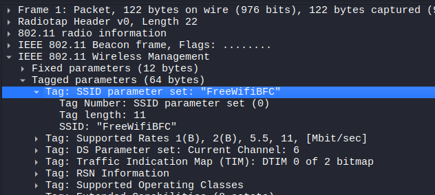

**Answer: `FreeWifiBFC`**

## 2. Recover the Wi-Fi Password

To attempt an offline dictionary attack, I first checked whether the capture contained a **WPA four-way handshake**. These EAPOL messages provide the material needed to test password candidates against a captured authentication exchange.

The following Wireshark display filter shows both beacon frames and EAPOL exchanges:

```wireshark
eapol || wlan.fc.type_subtype == 0x08
```

The capture contains EAPOL messages **1 through 4**, confirming that a handshake is available. The access point's BSSID is `22:c7:12:c7:e2:35`.

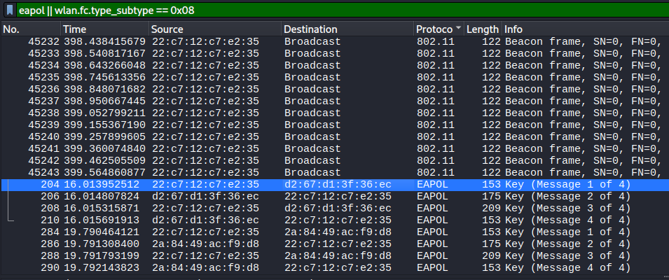

### Crack the handshake with Aircrack-ng

I used a classic `.pcap` version of the capture (`VanSpy_fixed.pcap`) for compatibility with my Aircrack-ng workflow. If starting from the original `.pcapng`, a reproducible conversion command is:

```bash
tshark -r VanSpy.pcapng -F pcap -w VanSpy_fixed.pcap
```

Then I ran a dictionary attack with `rockyou.txt`, restricting the target to the identified BSSID:

```bash
aircrack-ng -w /usr/share/wordlists/rockyou.txt \
  -b 22:c7:12:c7:e2:35 VanSpy_fixed.pcap
```

Aircrack-ng successfully recovered the passphrase:

```text
KEY FOUND! [ Christmas ]
```

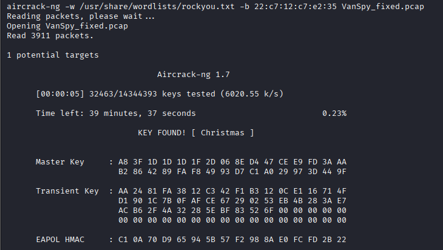

**Answer: `Christmas`**

> A captured handshake does not reveal the password directly. Aircrack-ng tests candidate passphrases offline until it finds one that validates against the handshake.

## 3. Decrypt Wireless Traffic and Identify the Suspicious Tool

With the Wi-Fi password recovered, I could decrypt the protected wireless traffic in Wireshark.

In **Edit → Preferences → Protocols → IEEE 802.11**, I enabled decryption and added a decryption key with:

- **Key type:** `wpa-pwd`
- **Key:** `Christmas:FreeWifiBFC`

Once decryption was enabled, higher-layer traffic such as IP and TCP became visible. I noticed a TCP conversation from `10.0.0.3` to `10.1.1.1` on destination port **4444**.

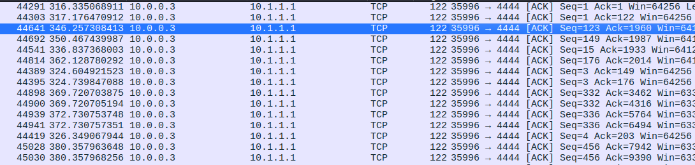

I inspected the conversation using **Follow → TCP Stream**. The stream exposed a Windows command session containing the distinctive Mimikatz banner and commands:

```text
mimikatz(commandline) # privilege::debug
Privilege '20' OK

mimikatz(commandline) # token::elevate
SID name : NT AUTHORITY\SYSTEM
```

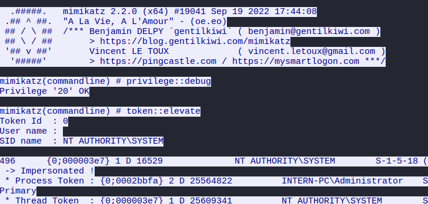

**Answer: `Mimikatz`**

Mimikatz is a Windows post-exploitation tool that can interact with credentials, tokens, and cryptographic material. In this case, the attacker used elevated privileges to export the certificate and private-key material associated with **Remote Desktop**. That export was the key to the next stage of the investigation.

## 4. Recover the RDP Private Key

The same captured command session showed a PowerShell command encoding an exported `.pfx` file in Base64:

```powershell
[Convert]::ToBase64String([IO.File]::ReadAllBytes("/users/administrator/LOCAL_MACHINE_Remote Desktop_0_INTERN-PC.pfx"))
```

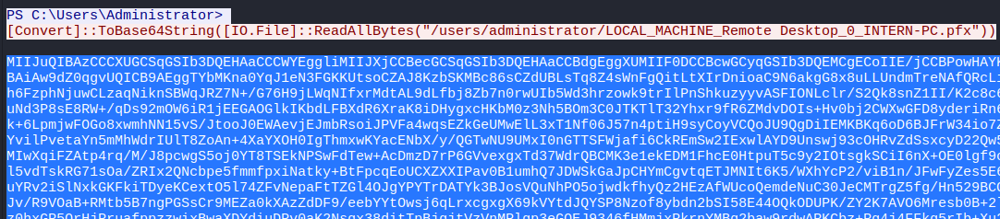

The resulting Base64 data was visible in the network stream. I copied it into a local file named `blob.txt`.

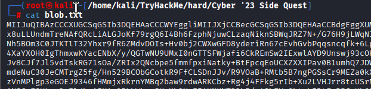

### 4.1 Decode the PFX archive

The `.pfx` file is a PKCS#12 container that can hold a certificate and its private key. I decoded the recovered Base64 string back into its binary format:

```bash
base64 -d blob.txt > juicy_file.pfx
```


### 4.2 Extract the private key with OpenSSL

I used OpenSSL to extract the private key from the PKCS#12 file:

```bash
openssl pkcs12 -in juicy_file.pfx -nocerts -out key.pem -nodes
```

When prompted for the **Import Password**, I used the PFX export password (`mimikatz` in this challenge). The `-nocerts` option excludes certificates, while `-nodes` writes the private key without encrypting the output.

I then converted the extracted key to an RSA private-key file:

```bash
openssl rsa -in key.pem -out server.key
file server.key
```

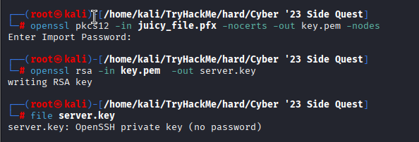

The resulting `server.key` was used for RDP/TLS decryption.

### 4.3 Configure RDP/TLS decryption in Wireshark

In **Edit → Preferences → Protocols → TLS → RSA keys list**, I added the private key with the values shown in the capture analysis:

| Field | Value |
|---|---|
| IP address | `10.0.0.2` |
| Port | `3389` |
| Protocol | `tpkt` |
| Key file | Path to `server.key` |
| Password | Leave blank (key is unencrypted) |

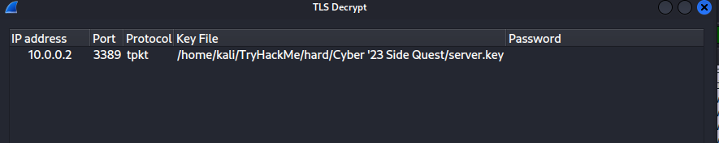

This allows Wireshark to decrypt the relevant RDP traffic **in this capture**. RSA private-key decryption depends on the TLS key-exchange method; it does not work for every modern TLS session, particularly those using ephemeral key exchange.

## 5. Find the CyberPolice Case Number

After configuring TLS decryption, I inspected the **decrypted RDP application data** using Wireshark's stream-following functionality.

Among the recovered data were HTML-formatted clipboard contents and a message referring to Detective Frost-eau and the ongoing investigation.

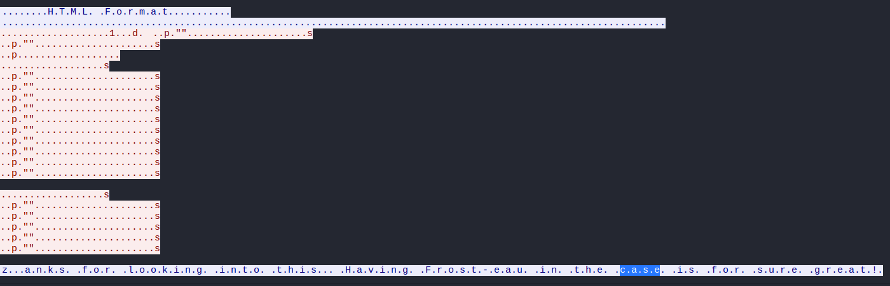

Searching further in the same decrypted data revealed the CyberPolice case identifier:

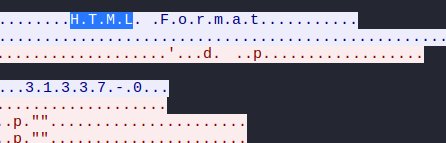

**Answer: `31337-0`**

## 6. Recover the Contents of `yetikey1.txt`

The last question asks for the content of `yetikey1.txt`. I continued examining the decrypted RDP stream and searched for the filename.

The string `yetikey1.txt` appeared in the recovered session data, showing that the file had been handled during the remote desktop activity.

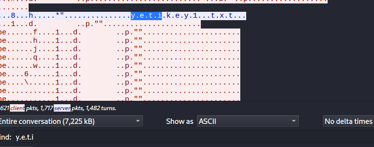

Inspecting the surrounding data revealed the file content. Wireshark displayed the ASCII characters separated by dots representing non-printable bytes, so I read the printable characters in sequence.

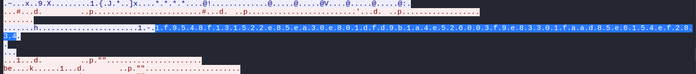

**Answer:**

```text
1-1f9548f131522e85ea30e801dfd9b1a4e526003f9e83301faad85e6154ef2834
```

This value is also the flag used to complete **Side Quest 1**.

---

## Answers Summary

| Question | Answer |
|---|---|
| Wi-Fi SSID | `FreeWifiBFC` |
| Wi-Fi password | `Christmas` |
| Suspicious tool | `Mimikatz` |
| CyberPolice case number | `31337-0` |
| `yetikey1.txt` contents | `1-1f9548f131522e85ea30e801dfd9b1a4e526003f9e83301faad85e6154ef2834` |

## Key Takeaways

This challenge demonstrates how an apparently opaque wireless capture can reveal multiple stages of an intrusion once the appropriate decryption material is recovered:

- **Wi-Fi forensics:** Identify an SSID and recover a weak WPA passphrase from a captured four-way handshake.
- **Network investigation:** Follow unusual TCP connections and recognize evidence of Windows post-exploitation activity.
- **Certificate and key handling:** Extract a Base64-encoded PKCS#12 archive and recover an RSA private key with OpenSSL.
- **RDP forensics:** Decrypt compatible RDP/TLS traffic and inspect clipboard data for sensitive information.

The most important lesson is the **chain of evidence**: cracking the Wi-Fi password exposed the attacker's session; that session revealed the RDP private key; and the key made it possible to recover the investigation details and final challenge flag.
